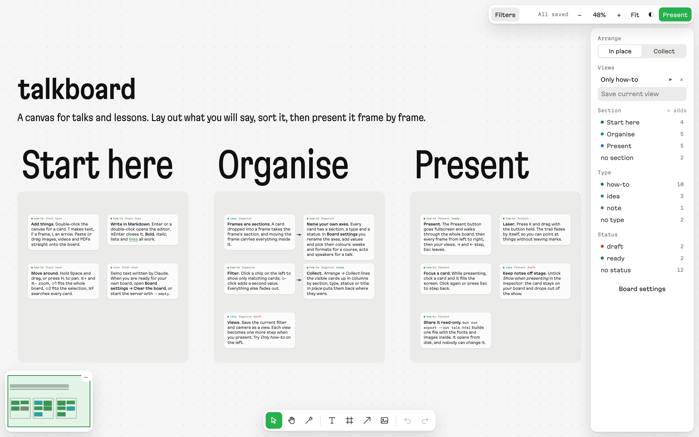

# talkboard

A local canvas for talks and lessons. You lay out cards, images and videos in frames, sort them on three axes you name yourself, and present the board frame by frame instead of a slide deck. When the talk is over, one command turns the board into a single read-only HTML file you can send to the audience.



## Run it

You need [Bun](https://bun.sh) 1.1 or newer. Nothing else gets installed.

```bash
git clone https://github.com/kirillgreen/talkboard
cd talkboard
bun start
```

Open http://127.0.0.1:4317. The first run copies a small demo board into `data/`; it explains the board on the board itself. To start blank, run `bun start --empty` on a fresh `data/` folder, or open **Board settings → Clear the board**.

| Flag | What it does |
|---|---|
| `--port 4320` | listen on another port (default 4317) |
| `--data ~/talks/autumn` | keep the board in another folder (default `./data`); one folder is one board |
| `--empty` | on a new data folder, start blank instead of copying the demo |
| `--git` | commit the data folder once an hour when something changed; the folder must sit inside a git repository |

The server listens on 127.0.0.1 only. Every card, frame and view is a JSON file in the data folder, and pasted images and videos sit next to them in `data/files/`, so you can back the board up, diff it or sync it like any other folder. A file no card has pointed to for a week is deleted by a daily cleanup, so Undo keeps working on anything you removed recently. Edits from another tab or another window show up live.

## Axes: section, type, status

Every card has three fields you can filter and group by. Their names and values are yours: open **Board settings** at the bottom of the left panel.

- rename an axis: «Section» can become «Week», «Act» or «Chapter»;
- add a value, rename it, or click its swatch to cycle through ten colours;
- delete a value: cards that had it lose it, and the toast offers Undo.

The section axis is special in one way: a frame can carry a section, and any card dropped inside that frame takes it. Type and status you set in the inspector on the right, where «new …» at the end of each list adds a value on the spot.

## Sorting the board

- **Filter.** Chips on the left show only matching cards; ⇧-click adds a second value. The rest fades out.
- **Collect.** *Arrange → Collect* lines the visible cards up in columns by section, type, status or title. *In place* returns them to their spots.
- **Views.** Save the current filter, layout and camera under a name. A view is one click away later and one step of the presentation.
- **Ignore filters.** A card with this box ticked in the inspector stays visible under any filter, which suits titles and legends.

## Presenting

**Present** (top right) goes fullscreen and steps through the whole board, then every frame from left to right, then your saved views.

| Key | While presenting |
|---|---|
| → · Space · Enter · PageDown | next step |
| ← · Backspace · PageUp | previous step |
| Home · End | first · last step |
| K | laser pointer on or off: drag to draw a trail that fades by itself |
| click a card | fill the screen with it; click again or Esc to step back |
| Esc | leave |

A card with *Show when presenting* unticked stays on your board and drops out of the show: good for speaker notes.

## Editing keys

| Key | Action |
|---|---|
| V · H · T · F · L · K | select · hand · text · frame · arrow · laser |
| P | present |
| double-click the canvas | new card |
| Enter · ⌘Enter | edit the selected card · finish editing |
| ⌘V or drag a file in | add an image, video or PDF |
| ⌘D · ⌘G · ⇧⌘G | duplicate · group · ungroup |
| [ · ] | send backward · bring forward |
| arrows · ⇧ arrows | nudge by 1 · 10 px |
| ⌘Z · ⇧⌘Z | undo · redo |
| ⌘+ · ⌘− · ⌘0 | zoom in · out · 100 % |
| ⇧1 · ⇧2 | fit the board · fit the selection |
| ⌘F | search all cards |
| Space + drag | pan |

Cards take Markdown: bold, italic, lists, links, headings.

## Sharing a read-only copy

```bash
bun run export --out talk.html
bun run export --out part-1.html --frames f-start --title "Part 1"
bun run export --data ~/talks/autumn --out autumn.html
```

The file carries the fonts, the images and the board inside, opens from disk without a server, and cannot be edited. `--frames` keeps only the listed frames and what lies inside them; frame ids are the file names in `data/elements/`. With [cwebp](https://developers.google.com/speed/webp/download) installed, images are downsized to 1600 px on the way in; without it they go in as they are.

## Layout of the code

```
server/server.ts   Bun server: JSON store, file uploads, live updates (SSE), image previews
server/export.ts   one-file read-only export
src/board.js       canvas, cards, frames, arrows, selection, undo
src/filters.js     axes, settings, filters, Collect, views, inspector, presenting, search, minimap
src/store-client.js  the browser side of the store
demo/              the board a new data folder starts with
fonts/             Martian Grotesk and Martian Mono
```

No build step and no dependencies: the server inlines the page, styles and scripts on each request.

## Licence

Code: MIT, see [LICENSE](LICENSE). Fonts: [Martian Grotesk](https://github.com/evilmartians/grotesk) and [Martian Mono](https://github.com/evilmartians/mono) by Evil Martians, under the SIL Open Font License 1.1, see `fonts/ofl-*.txt`.
